<!-- Generated by apps/controller/scripts/generate-erd.ts from the Controller's migrations. Regenerate it rather than editing it. -->

# Schema diagrams

The Controller's tables by area, as its migrations create them. What each table holds, and why, is in [schema.md](schema.md).

## Principals

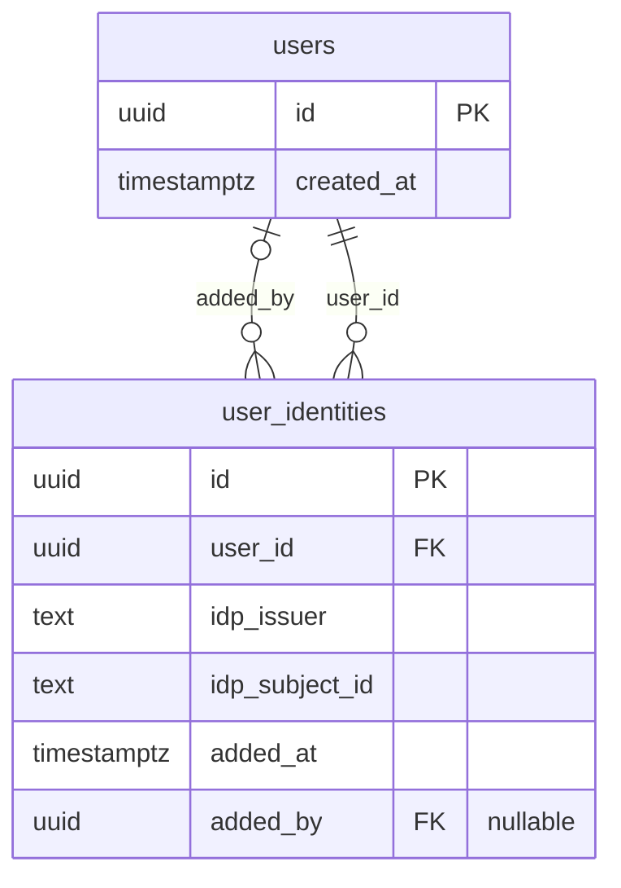

## Administrators

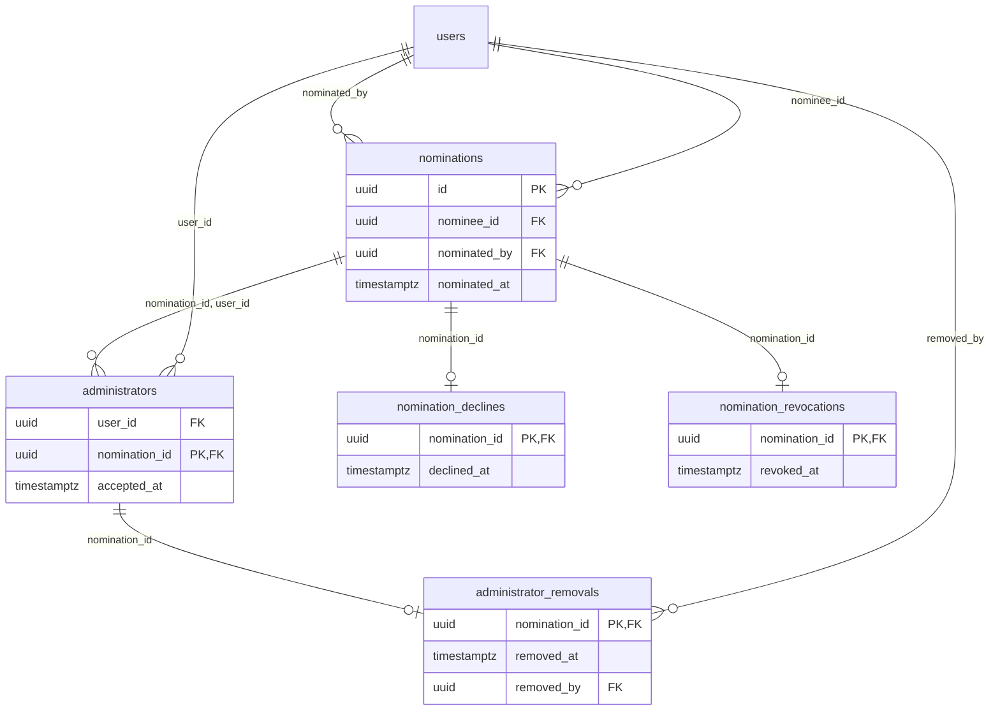

## Groups

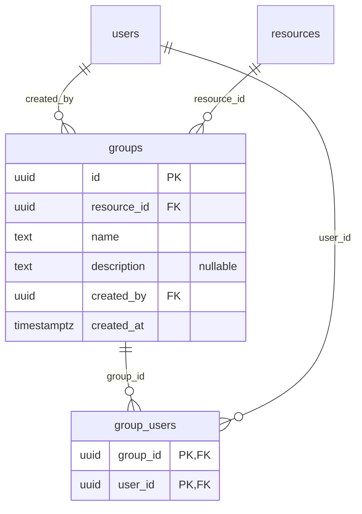

## Resources and categories

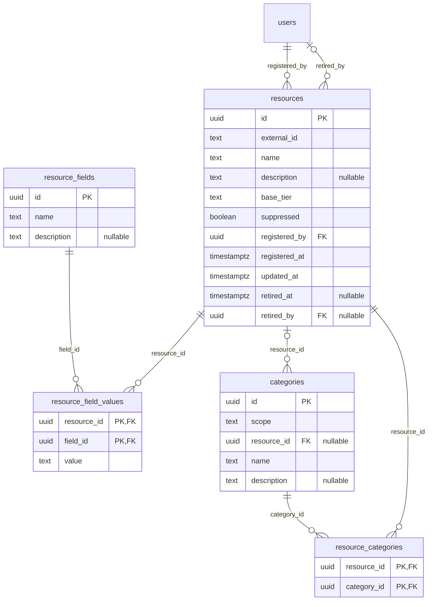

## Applications

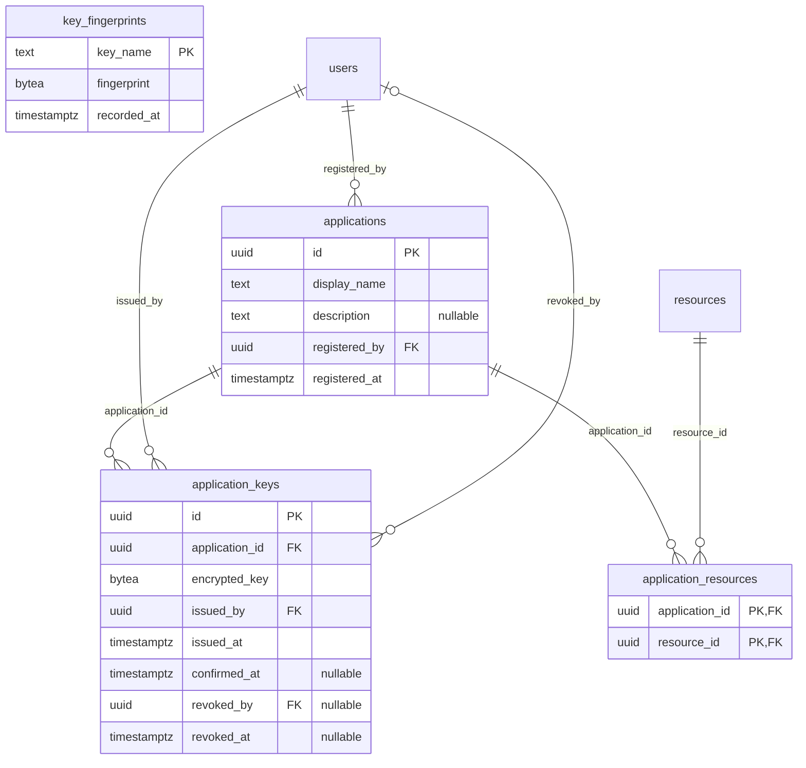

## Capabilities, roles and permissions

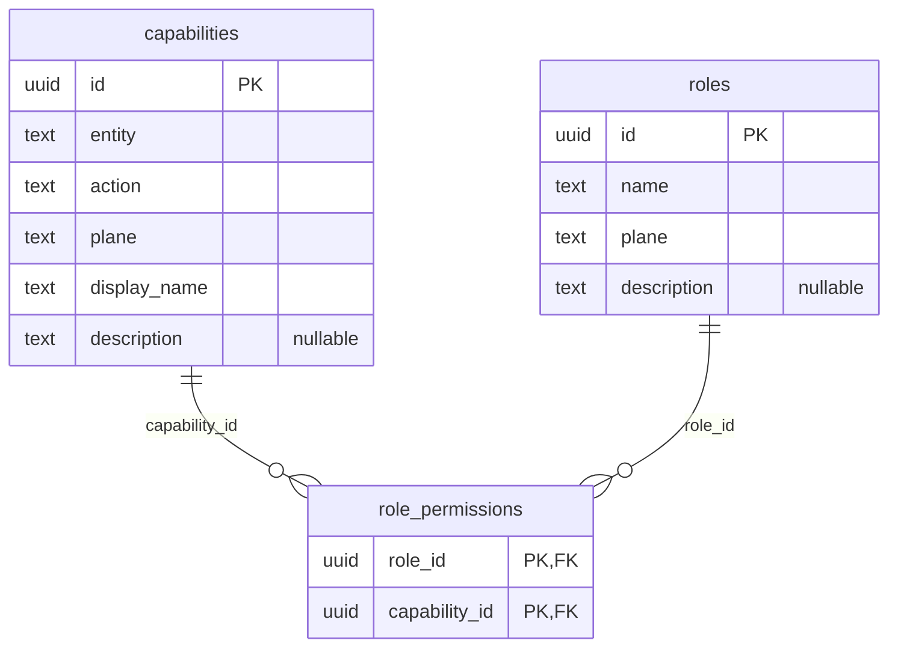

## Grants and invitations

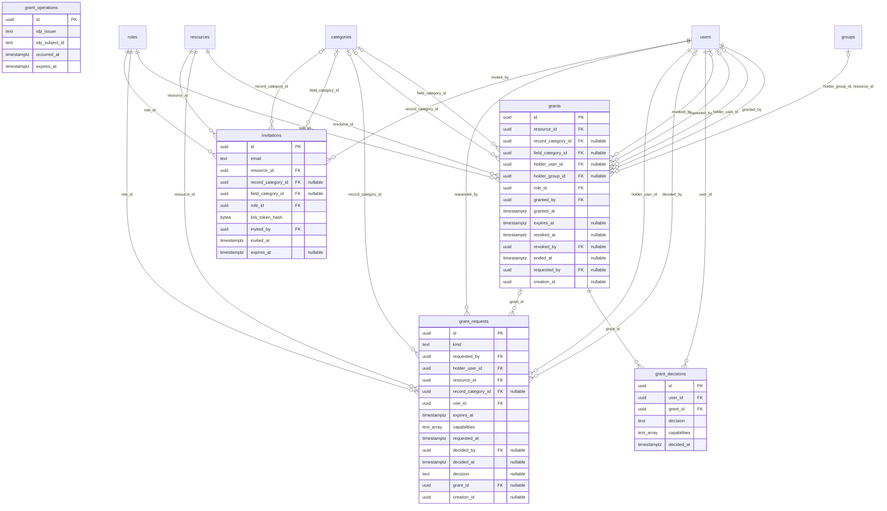

## Revocations and sign-outs

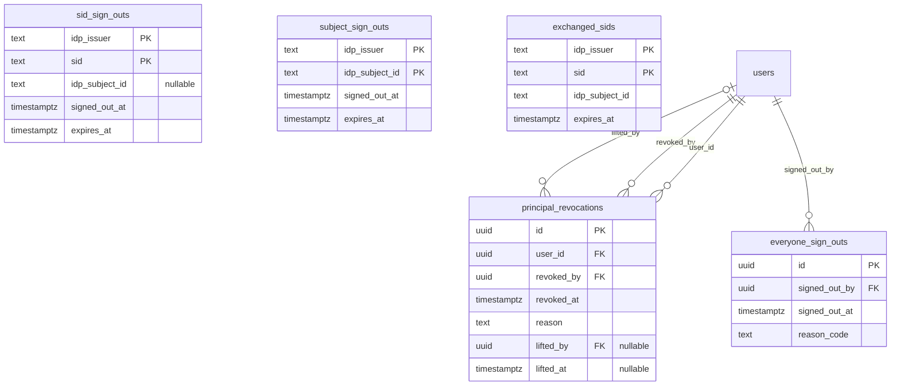

## The notice stream

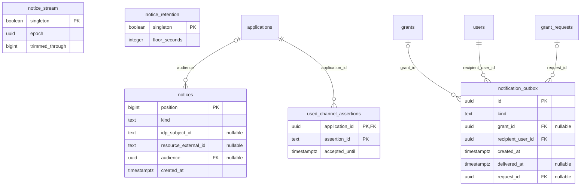

## Audit and change records

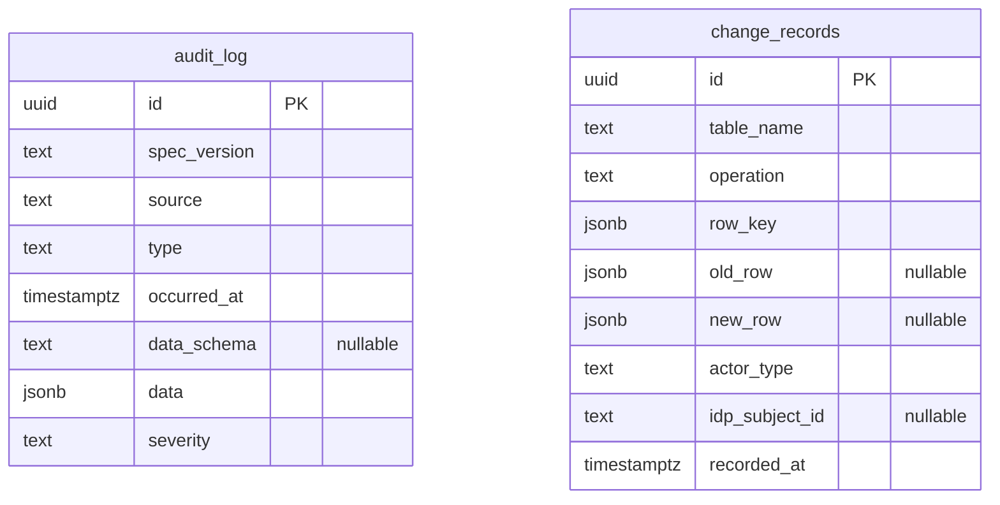

## Settings

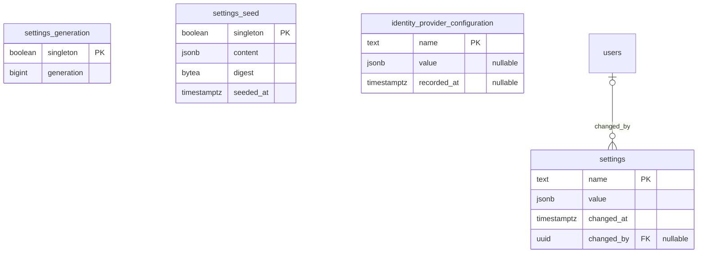

## Policy and schema state

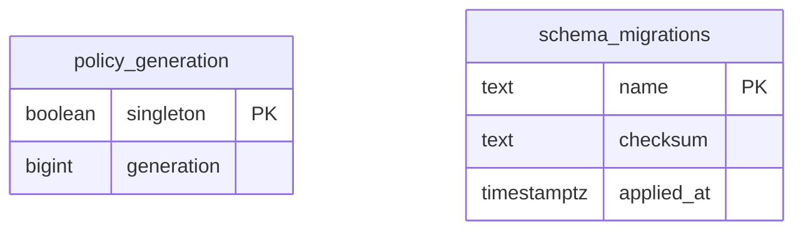
